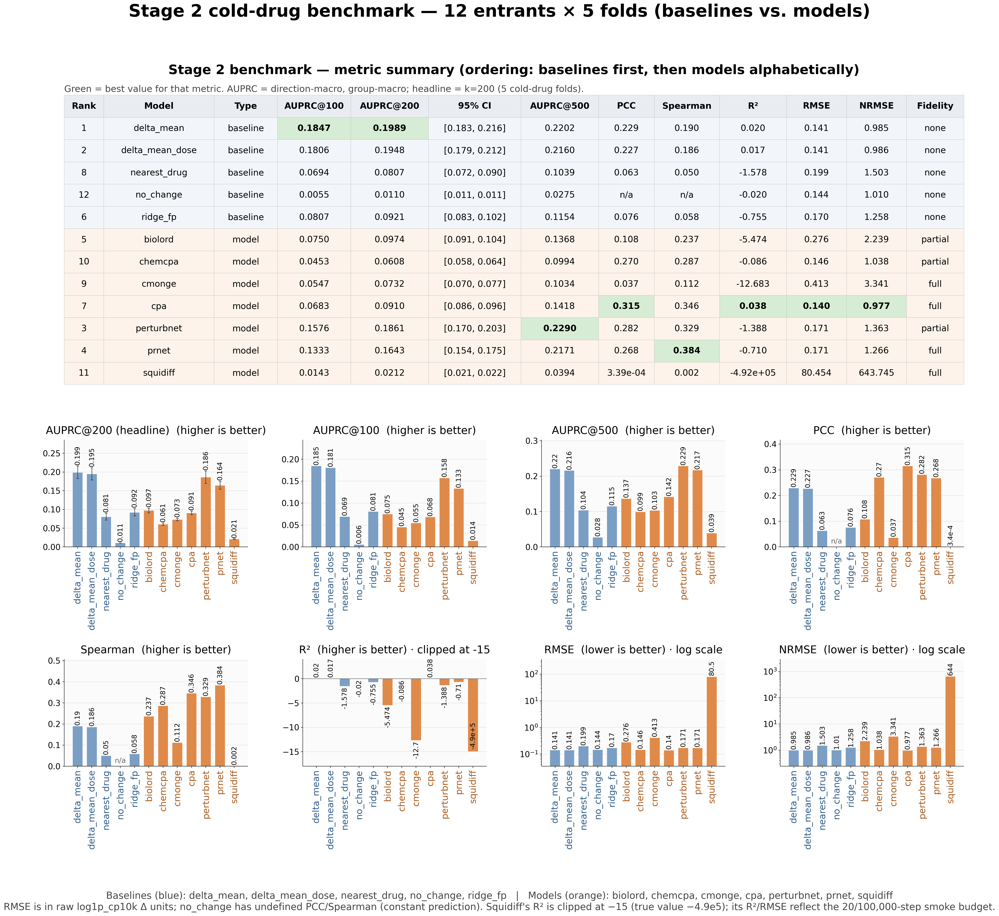

# 03_bench_models — Stage 2 cold-drug benchmark (archived)

The executed benchmark (60/60 units: five CPU baselines + seven real models ×
five folds) now lives entirely in `temp_env_all_18k/`. The per-model Python
environments were promoted to shared Stage 2 infrastructure at `stage2/_envs/`.
`temp_env_all_5k/` is a paired sensitivity run on a 5,000-gene HVG axis; it
does not replace the 18k result.

| path | content |
|---|---|
| `temp_env_all_18k/` | Complete 18,164-gene run archive: frozen `data/`, per-unit `output/`, evaluated `results/`, `configs/`, `models/` (configs + fidelity ledgers), `scripts/` (all benchmark code), the original `README.md`, `REPORT.md`, and `Makefile` |
| `temp_env_all_18k/summary.png` | Evaluation summary: one metrics table plus one bar panel per metric |
| `temp_env_all_18k/summary_table.csv` | The same metrics table as numbers |
| `temp_env_all_5k/` | Paired 5,000-gene HVG sensitivity run (derived data, same wells/splits/entrants); selection rule in `data/gene_set_5k.manifest.json`, decision in ADR 0028 |
| `../_envs/` | Shared Stage 2 environments (four `arc-stage2-bench-*` conda envs by name, `biolord`/`cmonge` venvs, and all lock files) |

## Summary figure



`summary.png` contains the metric table and eight bar panels (AUPRC@100,
AUPRC@200 with 95% CI, AUPRC@500, PCC, Spearman, R², RMSE, NRMSE). The ordering
is identical in the table and every panel: **baselines first, then models
alphabetically**.

- Baselines (blue): `delta_mean`, `delta_mean_dose`, `nearest_drug`,
  `no_change`, `ridge_fp`
- Models (orange): `biolord`, `chemcpa`, `cmonge`, `cpa`, `perturbnet`,
  `prnet`, `squidiff`

`summary_table.csv` holds the same table as numbers. Regenerate both with:

```bash
cd stage2/03_bench_models/temp_env_all_18k && python scripts/make_summary.py
```

## Notes

- Headline = k=200 direction-macro, group-macro AUPRC, five cold-drug folds.
  `delta_mean` remains the best entry (0.1989); PerturbNet (0.1861) is the best
  real model. See `temp_env_all_18k/REPORT.md` for the full analysis.
- The 5k sensitivity run keeps the same metric, entrants and folds but a
  5,000-gene axis; its chance floor at k=200 is 4.0%, not 1.1%. It changes the
  conclusion: PRnet beats `delta_mean` (+0.0243, paired CI +0.0113..+0.0367),
  while the 18k best entrant PerturbNet falls behind. Compare it paired against
  18k, never as a replacement leaderboard (ADR 0028).
- `no_change` has undefined PCC/Spearman (constant prediction) and is shown as
  `n/a`, not imputed.
- R² is displayed on a clipped axis at −15 (Squidiff's true value is −4.9e5);
  RMSE/NRMSE use log axes.
- `scripts/` moved back beside `data/`, `output/`, `results/`, and `configs/`,
  so the harness's original `HERE`-relative paths resolve again. The venv
  entries in `configs/models.json` now point at `stage2/_envs/`.
