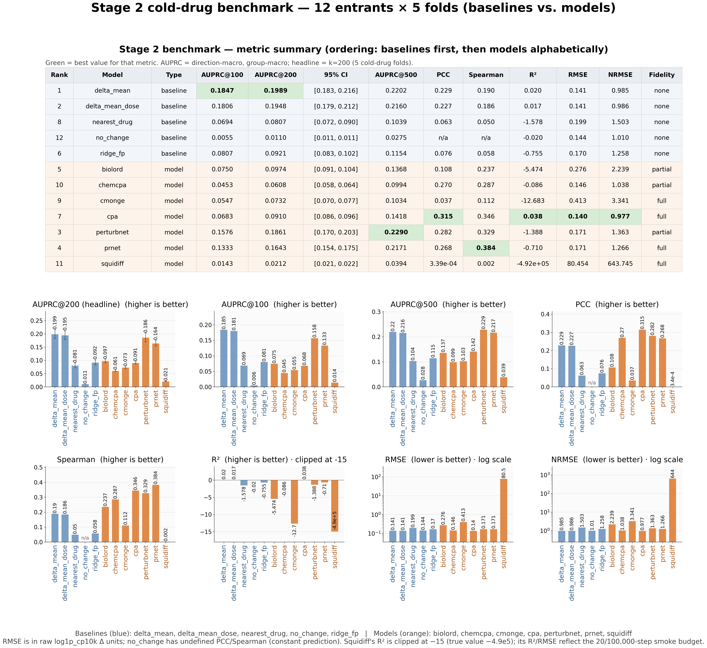

# 03.1_cold_drug_18k — the 18,164-gene cold-drug benchmark

> **Frozen banner — this benchmark predates the `02+04` merge.** Its inputs
> now live read-only in `stage2/_frozen/cm-data-v1/`; `02_cm_data` no longer
> produces them, and nothing here rebuilds or rewrites the frozen `output/`
> record. Redoing the benchmark on the merged corpus is a separate project.

**Status: executed** (2026-10-21/22). 60/60 units completed: five CPU baselines
plus seven real models × five cold-drug folds, under one fixed contract
(ADR 0027). This is the **primary** Stage 2 leaderboard.

## What it measures

A model must predict the transcriptome-wide response Δ of an **unseen drug**
from its structure and dose, never from its own perturbed cells. Δ is
`log1p_cp10k(treated) − mean(log1p_cp10k(same-plate DMSO))` on the frozen
`temp_env_all-smiles` view: 4,478 wells (4,206 treated / 272 control), 460 drug
keys, 18,164 genes, 1,380 drug×dose groups. Five cold-drug folds split the drugs
6:2:2 (276 train / 92 valid / 92 test); every drug is test exactly once and
valid exactly once. Test bundles are metadata-only, so no test expression enters
fit or checkpoint selection. Headline = direction-macro, group-macro **AUPRC at
k=200**, averaged over the five folds; a model needs all five folds to be
`winner_eligible`.

## Leaderboard (five cold-drug folds, k=200)

| rank | model | AUPRC@200 | 95% CI | k=100 | k=500 | PCC | Spearman | R² | RMSE | ideal_fit |
|---:|---|---:|---|---:|---:|---:|---:|---:|---:|---|
| 1 | `delta_mean` | **0.1989** | 0.1826–0.2162 | 0.1847 | 0.2202 | 0.2291 | 0.1899 | 0.0198 | 0.1406 | none |
| 2 | `delta_mean_dose` | 0.1948 | 0.1789–0.2116 | 0.1806 | 0.2160 | 0.2272 | 0.1860 | 0.0171 | 0.1407 | none |
| 3 | `perturbnet` | 0.1861 | 0.1699–0.2031 | 0.1576 | 0.2290 | 0.2816 | 0.3288 | −1.3878 | 0.1709 | partial |
| 4 | `prnet` | 0.1643 | 0.1545–0.1750 | 0.1333 | 0.2171 | 0.2681 | **0.3840** | −0.7099 | 0.1714 | full |
| 5 | `biolord` | 0.0974 | 0.0914–0.1040 | 0.0750 | 0.1368 | 0.1077 | 0.2371 | −5.4742 | 0.2762 | partial |
| 6 | `ridge_fp` | 0.0921 | 0.0828–0.1024 | 0.0807 | 0.1154 | 0.0761 | 0.0584 | −0.7552 | 0.1702 | none |
| 7 | `cpa` | 0.0910 | 0.0863–0.0960 | 0.0683 | 0.1418 | **0.3151** | 0.3457 | **0.0376** | **0.1395** | full |
| 8 | `nearest_drug` | 0.0807 | 0.0717–0.0902 | 0.0694 | 0.1039 | 0.0635 | 0.0502 | −1.5777 | 0.1988 | none |
| 9 | `cmonge` | 0.0732 | 0.0698–0.0767 | 0.0547 | 0.1034 | 0.0366 | 0.1121 | −12.6827 | 0.4134 | full |
| 10 | `chemcpa` | 0.0608 | 0.0578–0.0640 | 0.0453 | 0.0994 | 0.2704 | 0.2866 | −0.0863 | 0.1462 | partial |
| 11 | `squidiff` | 0.0212 | 0.0207–0.0218 | 0.0143 | 0.0394 | 0.0003 | 0.0023 | −491,660.9 | 80.4537 | full |
| 12 | `no_change` | 0.0110 | 0.0110–0.0110 | 0.0055 | 0.0275 | — | — | −0.0195 | 0.1445 | none |



**No entrant beats the constant training-mean baseline.** `delta_mean` scores
0.1989; the best entrant is PerturbNet at 0.1861, whose paired difference is
−0.0128 (95% CI −0.0248 to −0.0007). PerturbNet is nevertheless the best entrant
on the primary metric, CPA the best on PCC/R²/RMSE, PRnet the best on Spearman.
PerturbNet wins on the **median** drug (289/460) but loses on the mean because a
minority of drugs are catastrophic; the pre-registered metric is the mean, so
the leaderboard keeps the mean (the median is a descriptive warning, not a
second leaderboard). `no_change` reproduces the 1.1% prevalence exactly; its NaN
PCC/Spearman is the constant-prediction policy. Squidiff's row is a documented
**convergence failure**, not a ranking: cold-valid ε-MSE stayed ≈0.98 over
10⁵ steps at 90× the author gene space, and its DDIM samples are out of
distribution (RMSE 80.45). `summary.png` and `summary_table.csv` hold the full
table and per-metric bars; the per-model deviations from every author recipe are
in `execution/models/<model>/FIDELITY.md` (104 rows, `output/results/fidelity.csv`).

## Reproduce (three commands, from the repository root)

```bash
# 1. offline contract suite: data hashes, splits, metric sanity, adapter wiring
python -m unittest discover -s stage2/03_models_cmbench/03.1_cold_drug_18k/execution/tests -v

# 2. regenerate summary.png + summary_table.csv from output/results/leaderboard.csv
python stage2/03_models_cmbench/03.1_cold_drug_18k/execution/script/make_summary.py

# 3. independent acceptance checks over the 60 units
python stage2/03_models_cmbench/03.1_cold_drug_18k/execution/script/validate_run.py
```

A full rerun is `bash stage2/03_models_cmbench/03.1_cold_drug_18k/execution/script/run_queue.sh`
(GPU, 8–17 h per model; the run is resumable and skips completed units).
`execution/script/build_data.py --check` re-verifies the frozen input without
rebuilding it.

## Layout

`execution/` is the harness (`script/`, `configs/`, `models/`, `tests/`,
`Makefile`); `output/input/` is the frozen benchmark input; `output/units/` is
the regenerable per-unit artifact tree; `output/results/` holds the evaluated
tables; `summary.png` / `summary_table.csv` are the human deliverables at this
level. The frozen input manifest's paths are the historical 2026-10
pre-restructure form — they are evidence and are not rewritten.

## What this does and does not show

It shows that under one fixed cold-drug protocol at 18,164 genes the seven
capable models can be compared on identical groups, splits and metric, and that
the mean baseline is the benchmark to beat. It does **not** show that any model
is ready for MIRI drug scoring, that these numbers reproduce any author's
reported benchmark (gene space, corpus and budgets differ by design — see the
fidelity ledgers), or that a different HVG policy/budget would not change the
ranking: [the paired 5k sensitivity run](../03.2_hvg_sensitivity_5k/README.md)
shows it does. ADR 0027 fixes the contract; the follow-up selection (Squidiff
excluded, six candidates retained) is in
[`../../audit/model_selection_decisions.md`](../../audit/model_selection_decisions.md).
