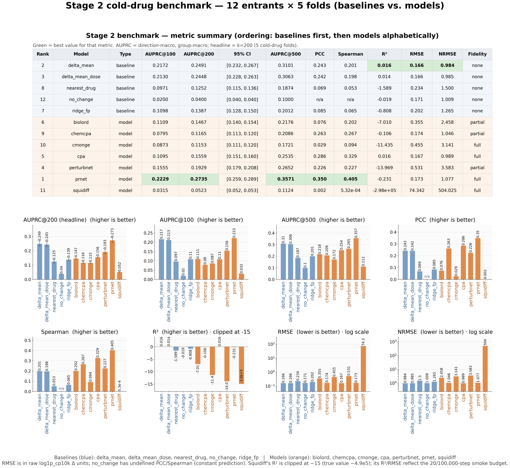

# 03.2_hvg_sensitivity_5k — the 5,000-gene HVG sensitivity benchmark

**Status: executed** (2026-10-22/23). 60/60 units completed: five CPU baselines
plus seven real models × five cold-drug folds, on a 5,000-gene HVG axis. This is
a **sensitivity fork** of [`../03.1_cold_drug_18k/`](../03.1_cold_drug_18k/), not
a replacement leaderboard (ADR 0028).

## What it measures

One question: does replacing the 18,164-gene output space with a 5,000-gene HVG
axis change the ranking? Wells, Δ, controls, groups, five cold-drug folds,
entrants, seeds, architectures, optimizers and budgets are identical to the 18k
run, and `build_data.py` verifies that parity column-by-column before writing.
Only the output width changes.

The axis is the 5,000 genes with the smallest sum of per-source HVG ranks over
`dtoxs_cm`, `screen_ctox` and `temp_env_all-smiles` (Scanpy Seurat
`dispersions_norm` on `layers["log1p_cp10k"]`, all wells, no `batch_key`; genes
outside a finite mean in `[0.0125, 3]` get the worst rank). The selection is
unsupervised and fixed across folds; it is declared in ADR 0028 and its
provenance is `output/input/gene_set_5k.manifest.json`. Because k stays absolute
(100/200/500), random prevalence at k=200 rises from 1.1% to **4.0%** — five
times the 18k denominator, so `no_change` reports 0.0400.

## Leaderboard (five cold-drug folds, k=200)

| rank | model | AUPRC@200 | 95% CI | fold 0 | fold 1 | fold 2 | fold 3 | fold 4 | ideal_fit |
|---:|---|---:|---|---:|---:|---:|---:|---:|---|
| 1 | PRnet | **0.2735** | 0.2590–0.2891 | 0.2872 | 0.2659 | 0.2664 | 0.2771 | 0.2707 | full |
| 2 | `delta_mean` | 0.2491 | 0.2321–0.2673 | 0.2662 | 0.2324 | 0.2417 | 0.2595 | 0.2459 | none |
| 3 | `delta_mean_dose` | 0.2448 | 0.2284–0.2625 | 0.2603 | 0.2290 | 0.2378 | 0.2560 | 0.2407 | none |
| 4 | PerturbNet | 0.1929 | 0.1790–0.2083 | 0.1964 | 0.1902 | 0.1863 | 0.2090 | 0.1824 | partial |
| 5 | CPA | 0.1559 | 0.1513–0.1605 | 0.1453 | 0.1642 | 0.1593 | 0.1681 | 0.1427 | full |
| 6 | biolord | 0.1467 | 0.1398–0.1539 | 0.1377 | 0.1473 | 0.1628 | 0.1364 | 0.1491 | partial |
| 7 | `ridge_fp` | 0.1387 | 0.1284–0.1501 | 0.1519 | 0.1354 | 0.1460 | 0.1295 | 0.1308 | none |
| 8 | `nearest_drug` | 0.1252 | 0.1155–0.1355 | 0.1288 | 0.1167 | 0.1211 | 0.1330 | 0.1264 | none |
| 9 | chemCPA | 0.1165 | 0.1129–0.1203 | 0.1141 | 0.1199 | 0.1226 | 0.1094 | 0.1164 | partial |
| 10 | CMonge | 0.1153 | 0.1108–0.1200 | 0.1128 | 0.1160 | 0.1238 | 0.1082 | 0.1155 | full |
| 11 | Squidiff | 0.0523 | 0.0517–0.0530 | 0.0527 | 0.0522 | 0.0537 | 0.0511 | 0.0519 | full (failure) |
| 12 | `no_change` | 0.0400 | 0.0400–0.0400 | 0.0400 | 0.0400 | 0.0400 | 0.0400 | 0.0400 | none |



PRnet is the only entrant above the mean baseline: paired gap **+0.0243**
(95% CI +0.0113 to +0.0367), it wins in all five folds and on the descriptive
`atc-moa` subset (0.2261 vs 0.2131), and it beats `delta_mean` on 62.2% of the
460 test drugs. The 18k best entrant does not survive as best entrant:
PerturbNet moves from −0.0128 to **−0.0563** versus the baseline. Squidiff still
fails to converge at 5,000 genes, so the gene space was not the cause of its
18k failure. The full paired analysis, secondary metrics and limitations are in
`output/results/comparison_18k.csv` and the per-model fidelity ledgers.

## Reproduce (three commands, from the repository root)

```bash
# 1. offline contract suite: gene set, data parity, splits, metric sanity, adapters
python -m unittest discover -s stage2/03_models_cmbench/03.2_hvg_sensitivity_5k/execution/tests -v

# 2. regenerate summary.png + summary_table.csv from output/results/leaderboard.csv
python stage2/03_models_cmbench/03.2_hvg_sensitivity_5k/execution/script/make_summary.py

# 3. paired per-drug comparison against the 18k run
python stage2/03_models_cmbench/03.2_hvg_sensitivity_5k/execution/script/compare_18k.py
```

A full rerun is `bash stage2/03_models_cmbench/03.2_hvg_sensitivity_5k/execution/script/run_queue.sh`
(GPU; total measured wall time 12.7 h). Rebuilding the axis and the frozen data
is `execution/script/build_gene_set.py` then `execution/script/build_data.py`
(the second verifies 18k parity), and `build_data.py --check` re-verifies the
checked-in input.

## Layout

`execution/` is the harness (`script/`, `configs/`, `models/`, `tests/`,
`Makefile`); `output/input/` is the frozen 5k input (the three gene-set tables
plus the shared wells/splits); `output/units/` is the regenerable per-unit
artifact tree; `output/results/` holds the evaluated tables; `summary.png` /
`summary_table.csv` are the human deliverables at this level. The frozen input
manifest's paths are the historical 2026-10 pre-restructure form — they are
evidence and are not rewritten; `"benchmark": "temp_env_all_5k"` there is the
historical benchmark id and also stays.

## Relationship to the 18k run

The 18k run remains primary: this run answers one sensitivity question and its
absolute AUPRC is **not** comparable with 18k (prevalence differs 3.6× at k=200)
— use paired gaps and ranks. The finding is that the "no entrant beats the mean
baseline" conclusion is gene-space dependent: PRnet is close to the baseline at
18k (−0.0345) and above it at 5k (+0.0243). It does not overturn ADR 0027, and
the result must not be re-tuned on.
