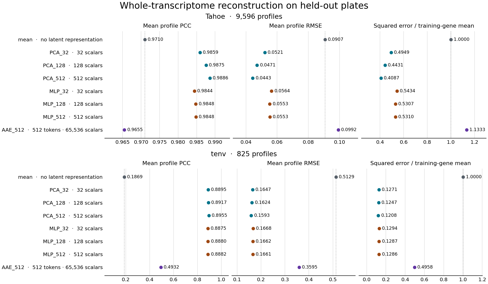

# 07_autoencoder — whole-transcriptome reconstruction

Step 07 compares methods that reconstruct a measured expression profile from
itself. It uses the corrected [Step 02 shared CM release](../02_dataset_corpus/README.md)
with 18,164 ordered genes and measured FAM153B in both Tahoe and tenv.
[ADR 0052](../../docs/adr/0052-stage2-autoencoder-reconstruction-boundary.md)
defines the benchmark. Step 08 owns perturbation prediction and its integration
checks. The [historical Latent XPert workflow](../_archive/07_lxpert/README.md)
contains the earlier checkpoint, figure and treatment smoke.

## Frozen split

Plates are ranked separately within each source using SHA-256 over the original
JSON serialization of `[20261109, source, plate]`. The first fifth, rounded
down, is validation. The next equally sized block is test, and the remaining
plates are training. The [frozen split](output/split.json) lists every plate
by role, the ranked-plate digest, and each role's ordered profile membership
digest. Membership uses expression row, native row, profile ID and plate,
in release row order. Loading the split verifies its corpus manifest, gene
order, ranks, memberships and full coverage.

| Source | Train plates / profiles | Validation plates / profiles | Test plates / profiles |
| --- | ---: | ---: | ---: |
| Tahoe | 10 / 47,822 | 2 / 9,600 | 2 / 9,596 |
| tenv | 10 / 2,810 | 3 / 843 | 3 / 825 |

## Held-out reconstruction comparison

Each of the eight configurations reconstructed the same 9,596 Tahoe and 825
tenv test profiles. The [selection seal](output/test_seal.json) was committed
before scoring. It binds the selected validation scores, fitted manifest and
payload hashes to the corrected corpus, ordered gene axis and frozen split.



`PCA_512` led all three metrics on both sources. Its squared error was 40.9%
of the training-gene mean's error on Tahoe and 12.1% on tenv. `AAE_512` had
113.3% of the mean's squared error on Tahoe and 49.6% on tenv.

The [test scores](output/test_scores.json) give full-precision metrics,
including the number of defined PCCs and the profile count for every source
and configuration. The dotted line marks the training-gene mean in each panel.
The [original comparison](../_archive/07_lxpert/README.md) remains in the archive
with its checkpoint and perturbation smoke.

### Replay the published scores

The [Step 02 shared CM release instructions](../02_dataset_corpus/README.md#shared-cm-expression-release)
give the build and verification commands for `output/corpus/shared-cm-v1`,
including `genes.csv` in model order. The release's
[verification record](../02_dataset_corpus/execution/build_record/shared_cm_v1.json)
pins its manifest. Step 07 publishes [the frozen split](output/split.json)
and [the fitted artifacts](output/models/). Fit and validation resource records
are available for [mean](execution/mean_record/run.json),
[PCA](execution/pca_record/run.json), [MLP](execution/mlp_record/run.json), and
[AAE](execution/aae_record/run.json).

From the repository root in the `arc` environment, run replay with fresh
resource admission as recorded in the [comparison run](execution/comparison_record/run.json).
Replay verifies the seal, loads all eight published artifacts and checks the
published scores with relative tolerance `1e-6` and absolute tolerance `1e-8`.
Mean and PCA score on CPU. MLP and AAE score on CUDA. Run CUDA jobs serially
and check free GPU memory with `nvidia-smi` before starting. The replay record
uses a 5,120 MiB free GPU memory floor. Use `run_step07` from this block for
the fit and validation examples below in the same shell.

```bash
run_step07() {
  local available
  available=$(free -g | awk '/^Mem:/ {print $7}')
  if [ "${available:-0}" -lt 12 ]; then
    printf 'Step 07 requires at least 12 GiB of available RAM.\n' >&2
    return 1
  fi
  systemd-run --user --scope -p MemoryMax=10G -p MemorySwapMax=8G -- \
    /usr/bin/time -v env OMP_NUM_THREADS=2 MKL_NUM_THREADS=2 OPENBLAS_NUM_THREADS=2 \
    NUMEXPR_NUM_THREADS=2 python "$@"
}

step=stage2/07_autoencoder
cli="$step/execution/script/compare.py"
scores="$step/output/test_scores.json"
run_step07 "$cli" reload --allow-test --expected "$scores"
python "$cli" figure --expected "$scores" --output /tmp/arc-reconstruction-test.png
```

## Fit, score and replay

From the repository root in the `arc` environment, schedule real commands
serially under the [resource limits](../../docs/agents/execution-environment.md).
The CLI checks every release payload against the manifest previously verified
by Step 02. It memory-maps the expression matrices and reads bounded batches.

```bash
cli=stage2/07_autoencoder/execution/script/reconstruct.py
run_step07 "$cli" freeze-split --split /tmp/arc-split.json
run_step07 "$cli" fit --split /tmp/arc-split.json --output /tmp/arc-mean
run_step07 "$cli" score --split /tmp/arc-split.json --artifact /tmp/arc-mean \
  --role validation --output /tmp/arc-mean-validation.json
run_step07 "$cli" reload --split /tmp/arc-split.json --artifact /tmp/arc-mean \
  --role validation --expected /tmp/arc-mean-validation.json
```

The published split and [mean artifact](output/models/mean/manifest.json) are
the defaults for scoring. The mean reduces all joint training rows in float64,
casts the result to float32 once and broadcasts the same vector to every
profile. Each published artifact carries the corpus, ordered gene axis, split
and file digests. Replay checks this binding and independently recomputes the
score report with relative tolerance `1e-6` and absolute tolerance `1e-8`.

The scorer computes PCC and RMSE across genes per profile, then averages
profiles equally within each source. A profile has undefined PCC if either
vector has zero variance. The report includes the number of defined PCCs and
uses JSON `null` when none are defined. MSE averages all squared residuals
within a source. Relative squared error divides the model's summed squared
residuals by the training-gene mean's summed squared residuals on the same
profiles and is `null` if the denominator is zero.

The library exposes `Corpus.read(source, rows)`, verified row memberships
at `Split.rows[source][role]`, and `score(corpus, split, role, predict, mean,
batch_size)`. Entrants pass a batch prediction function returning an array
in the same row and gene order. `publish_artifact` provides a staging directory
for the fitted payloads and publishes them with a manifest as one directory.
`verify_artifact` checks the binding and digests before reload. Epoch-based
entrants select fitted artifacts using tenv validation MSE. Each corpus read
and configurable batch is limited to 1,024 profiles. For final publication,
`compare.py score` and `compare.py reload` require `--allow-test` and verify
the selection seal before scoring real test profiles. Per-artifact test
scoring is available for bounded fixtures.

Run bounded fixtures with
`python -m unittest discover -s stage2/07_autoencoder/execution/tests`.

The mean fit used 50,632 profiles across the two sources. Independent validation
replay reproduced the [score report](execution/mean_record/validation.json)
byte-for-byte. The [run record](execution/mean_record/run.json) gives the
admission measurements and peak RSS.

| Source | Validation profiles | Mean PCC | Mean RMSE | Relative squared error |
| --- | ---: | ---: | ---: | ---: |
| Tahoe | 9,600 | 0.978971 | 0.074663 | 1.0 |
| tenv | 843 | 0.184086 | 0.512094 | 1.0 |

### PCA reconstruction

One joint training fit estimates the per-gene center and a 512-component basis.
The solver starts with a Gaussian sketch seeded at 20261109, oversamples by 64,
and applies eight streamed covariance products with reduced QR after each pass.
Rayleigh–Ritz orders the resulting directions by variance. The covariance
products use float32 at the highest matmul precision. Each artifact carries
its exact prefix of the basis and the fitted center. Inference projects the
centered profile, maps it back into expression space and adds the center.

```bash
cli=stage2/07_autoencoder/execution/script/reconstruct.py
run_step07 "$cli" fit --model PCA --device cuda --batch-size 512 --output /tmp/arc-pca
for rank in 32 128 512; do
  artifact="stage2/07_autoencoder/output/models/PCA_$rank"
  scores="/tmp/arc-pca-validation-$rank.json"
  run_step07 "$cli" score --artifact "$artifact" --role validation --output "$scores"
  run_step07 "$cli" reload --artifact "$artifact" --role validation --expected "$scores"
done
```

The example scores the published artifacts. To validate a new fit, use the
rank directories written under `/tmp/arc-pca`. CPU scoring and replay use the
same published training-gene mean reference as the other methods. Use
`--mean-artifact` if the reference was fitted to a fixture or another release.

### MLP reconstruction

Each `MLP_k` fits a separate fully connected autoencoder with widths
18,164 → 512 → *k* → 512 → 18,164. GELU follows the two 512-wide hidden
layers. The bottleneck and output are linear, and *k* counts scalars.
The frozen recipe uses float32, full-axis MSE, AdamW with learning rate
0.001 and weight decay 0.01, and 20 epochs of 512-profile batches. A
PCG64 shuffle seeded by 20261109 and the epoch visits every joint training
profile once at the natural source ratio. Each fit has a 30-minute ceiling.
Validation uses 64-profile batches, records MSE separately by source, and
selects the earliest epoch at the minimum tenv MSE.

```bash
cli=stage2/07_autoencoder/execution/script/reconstruct.py
for width in 32 128 512; do
  artifact="/tmp/arc-MLP_$width"
  scores="/tmp/arc-MLP_$width-validation.json"
  run_step07 "$cli" fit --model "MLP_$width" --device cuda --output "$artifact"
  run_step07 "$cli" score --artifact "$artifact" --device cuda --role validation --output "$scores"
  run_step07 "$cli" reload --artifact "$artifact" --device cuda --role validation --expected "$scores"
done
```

### Attention Autoencoder reconstruction

`AAE_512` uses 512 latent queries, 128 channels per query and eight attention
heads. It contains 65,536 latent scalars per profile. Fixed sinusoidal positions
encode the order of the 18,164 genes. The encoder queries all measured
expression values and the decoder uses the same ordered gene positions to
reconstruct the full profile.

The frozen recipe uses full-axis MSE, AdamW with learning rate 0.001 and
weight decay 0.01, and four epochs of 32-profile batches. A PCG64 shuffle
seeded by 20261109 and the epoch visits every joint training profile once.
Training has a 30-minute ceiling. The earliest epoch at the minimum tenv
validation MSE selects the checkpoint, and Tahoe validation MSE is recorded
separately. Real fitting and scoring require native CUDA BF16 and use
FlashAttention exclusively. Validation, scoring and replay use the same
32-profile batch size. The bounded CPU fixture uses float32, three epochs
and two-profile batches.

```bash
cli=stage2/07_autoencoder/execution/script/reconstruct.py
artifact=/tmp/arc-AAE_512
scores=/tmp/arc-AAE_512-validation.json
run_step07 "$cli" fit --model AAE_512 --device cuda --output "$artifact"
run_step07 "$cli" score --artifact "$artifact" --device cuda --role validation --output "$scores"
run_step07 "$cli" reload --artifact "$artifact" --device cuda --role validation --expected "$scores"
```
